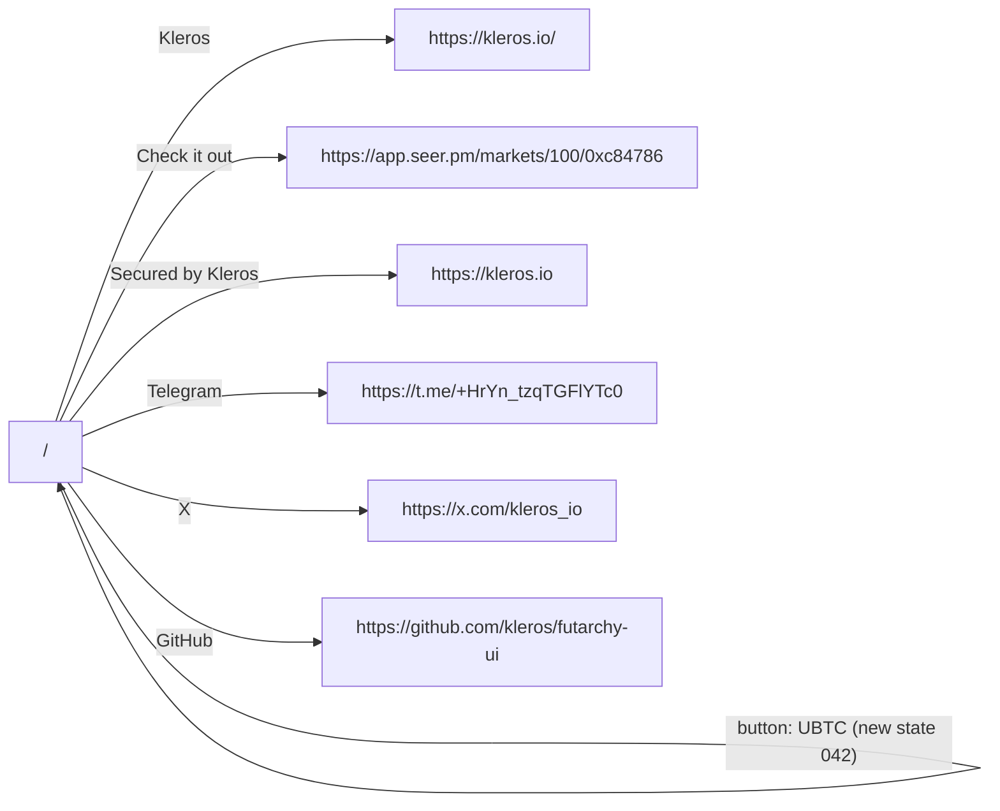

# Observed flows (generated from real clicks; NOT guesses)
Edges are real transitions recorded by the crawler (page --control--> page/state). Render with any Mermaid viewer. A flow that is not here was not observed: verify it manually before drawing it in the redesign.

